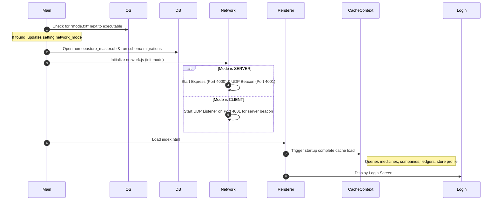
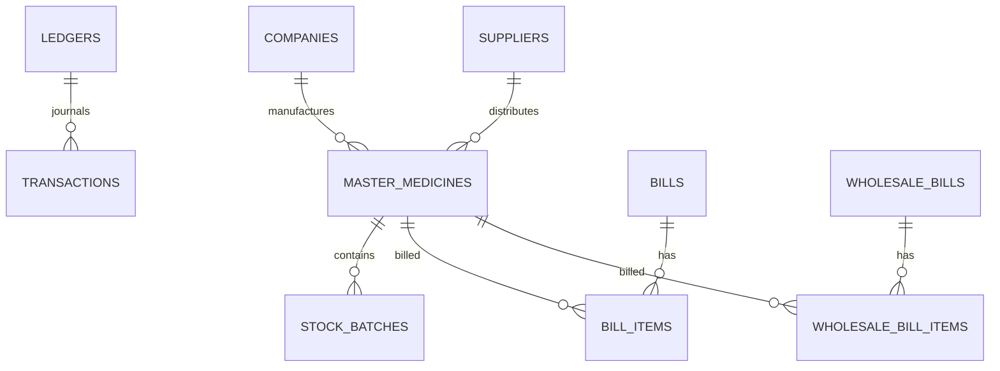

# HomoeoStore ERP - Development Specifications & Architecture Blueprint

This document serves as the comprehensive development lifecycle manual for **HomoeoStore ERP**. It consolidates the Product Requirements, Technical Specifications, System Flows, UI/UX Standards, Database Schema, and Build/Packaging Workflows into a single source of truth.

---

## 1. Product Requirement Document (PRD)

### 1.1. Product Overview & Vision
**HomoeoStore ERP** is a high-performance desktop application designed specifically for homeopathic pharmacies, retail clinics, and wholesale distributors. The platform streamlines medical inventory control, manages multi-potency stock variations (e.g., dilutions, mother tinctures, tablets), automates retail/wholesale billing (GST-compliant), handles dual-entry accounting, and ensures zero data loss via robust local and cloud backup systems.

### 1.2. Key User Personas
1. **Store Owner / Admin**: Has full access. Manages store profile, security credentials, database backups, financial years, inventory margins, and wholesale ledger accounts.
2. **Billing Clerk / Operator**: Primary user of the retail billing terminal. Needs fast, keyboard-first UI for rapid search, checkout, and receipt printing. Access is restricted to point-of-sale modules.
3. **Accountant / Auditor**: Inspects double-entry transaction ledgers, daybooks, tax reports (GSTR-1, GSTR-2), balance sheets, and profit-and-loss accounts.

### 1.3. Scope & Key Modules
*   **Authentication & Security**: Five-digit secure PIN lock with instant auto-login when typing finishes on the login page.
*   **Startup Loader**: Parallel initialization of global configuration tables to support near-instant search indexing.
*   **Multi-Potency Inventory Manager**: Medicine cataloging based on name, manufacturer, potency (power), category, pack size, and rack location. 
*   **Point of Sale (Retail Billing)**: Fast barcode/text search, automatic batched inventory deduction, and one-click thermal POS printing.
*   **Wholesale Invoice Manager (B2B)**: Multi-discount matrixes, scheme percentage calculation, transporter details (E-Way bill info), and printable ledger receipts.
*   **Double-Entry Bookkeeping**: Accounts ledger creation, daybooks, debit/credit journal entries, and automated financial statements.
*   **Expiry & Reorder Alert System**: Automated tracking of near-expiry batches and low-stock indicators.
*   **Multi-Terminal Network Mode**: Capability to install the application as a standalone system, a server system, or a client system connecting via local LAN without complex server installs.

---

## 2. Technical Requirement Document (TRD)

### 2.1. System Architecture
The application runs on **Electron**, dividing operations into a system-level Main Process and a web-based React Renderer Process.

*   **Main Process**: Handles operating system resources, coordinates direct database interaction (`better-sqlite3`), hosts local HTTP Express APIs in server mode, broadcasts network location beacons via UDP sockets, and manages local printing.
*   **Preload Bridge (`preload.js`)**: Exposes safe, context-isolated IPC channels to secure rendering layers without risking Node.js injection.
*   **Renderer Process**: Runs React (built via Vite) containing state contexts (`CacheContext`, `DialogContext`) and visual styling.

### 2.2. Network & Deployment Topology (Multi-Mode)
To accommodate different store setups, the app operates in one of three installer-defined modes:

```
+---------------------------------------------------------------------------------+
|                                NETWORK MODES                                    |
+---------------------------------------------------------------------------------+
| 1. STANDALONE (LOCAL)                                                           |
|    [ React UI ] ---> [ Preload Bridge ] ---> [ Local DB (better-sqlite3) ]      |
+---------------------------------------------------------------------------------+
| 2. SERVER MODE                                                                  |
|    [ React UI ] ---> [ Preload Bridge ] ---> [ Local DB (better-sqlite3) ]      |
|                                                      ^                          |
|                                                      | (HTTP Express Port 4000) |
|    [ Client UI (Remote PC) ] ------------------------+                          |
+---------------------------------------------------------------------------------+
| 3. CLIENT MODE                                                                  |
|    [ React UI ] ---> [ Preload Bridge ] ---> [ Axios POST ] ---> [ Server IP ]  |
+---------------------------------------------------------------------------------+
```

*   **Standalone (LOCAL)**: Entirely offline. Database queries execute directly against local SQLite files.
*   **Server Mode (SERVER)**: Starts an Express API server on port `4000` to handle external DB requests. Simultaneously runs a UDP socket beacon on port `4001` broadcasting `{"app": "HomoeoStore", "ip": "192.168.x.x"}` every 3 seconds.
*   **Client Mode (CLIENT)**: Binds a UDP socket on port `4001` to listen for beacons. Once discovered, it routes all database queries via Axios HTTP POST requests to the main system's port `4000`.

### 2.3. Key Technology Stack
*   **Runtime & Framework**: Electron (v30.5) & React (v18.2)
*   **Bundler**: Vite (v5.1)
*   **Database**: SQLite (`better-sqlite3` native bindings)
*   **Networking**: Node `dgram` (UDP sockets) & Express (HTTP server)
*   **Typography & Styling**: Outfit Font (via Fontsource), Vanilla CSS
*   **Utilities**: `qrcode` (payment link graphics), `html2pdf.js` & `jspdf` (digital PDF exports), `react-to-print` (custom invoices)

---

## 3. App Flow

### 3.1. Startup Initialization Flow



### 3.2. Transaction Flow (Retail Invoice Checkout)
1. **User Action**: Enters medicine query.
2. **Cache hit**: Matches cached items in `CacheContext` to display instant autocomplete suggestions.
3. **Draft Item Added**: App reads batch options from master database, calculating taxes (CGST/SGST/IGST) and totals.
4. **Checkout Triggered**: Passes transaction detail to Main Process via IPC call `create-bill`.
5. **Database Lock**: Performs atomic stock deduction in `master.stock_batches` and records bill metadata inside `FY_YYYY_YYYY.db` within a transaction block.
6. **Print Execution**: Dispatches receipt data directly to the local thermal printer queue or renders printable invoice component.

---

## 4. UI/UX Flow

### 4.1. Design & Typography Language
*   **Typography**: The app enforces the `Outfit` font family across all modules for a modern, clean sans-serif aesthetic.
*   **Theme Palette**: Soft slate-blue accent tones combined with high-contrast neutral backgrounds (`#ffffff` and `#334155`).
*   **Layout Layering**: Page structures contain fixed headers, scrollable list-view ports (using `react-window` virtualized lists for medicine indexes), and sticky totals blocks in checkout templates.

### 4.2. Interactive Elements Behavior
*   **5-Digit Pin Login**: When the user enters their PIN on the login screen, the state listener checks length. Once `length === 5`, it fires the remote login method automatically, saving the user from hitting "Enter" or clicking "Submit".
*   **Heavy Dropdown Menus**: Inputs for selecting Medicines and Companies handle large catalogs. On initialization, they render virtualized results to avoid layout thrashing. Autocomplete selection supports `maxItems={1000}`.
*   **Keyboard Shortcuts**:
    *   `F2`: Fast-switch focus to medicine search input.
    *   `F8`: Trigger instant invoice payment and receipt print.
    *   `ESC`: Dismiss popup dialogs or clear current invoice.

---

## 5. Backend Database Schema

To support multi-year accounting, the app attachment-links a year-specific transaction database with a global metadata database.



### 5.1. Global Master Database (`homoeostore_master.db`)

#### Table: `store_profile`
Holds store contact and license details.
*   `id` (INTEGER, Primary Key, Autoincrement)
*   `store_name` (TEXT, Not Null)
*   `address_line1`, `address_line2`, `address_line3` (TEXT)
*   `phone`, `email` (TEXT)
*   `gstin`, `dl_no` (TEXT)
*   `dl_expiry` (DATE)
*   `mfg_lic_no`, `admin_pin` (TEXT)
*   `bank_name`, `account_number`, `ifsc_code`, `qr_code` (TEXT)
*   `created_at` (DATETIME, Default: Current Timestamp)

#### Table: `companies`
Manufacturers details.
*   `id` (INTEGER, Primary Key, Autoincrement)
*   `name` (TEXT, Not Null)
*   `address1`, `address2`, `address3`, `phone`, `email` (TEXT)
*   `gstin`, `dl_no` (TEXT)
*   `tax_structure` (TEXT, Default: 'Product Wise')
*   `cgst`, `igst`, `cess` (REAL)

#### Table: `medicines`
Global medicine master index.
*   `id` (INTEGER, Primary Key, Autoincrement)
*   `name` (TEXT, Not Null)
*   `company`, `category`, `potency` (TEXT)
*   `purchase_price`, `selling_price` (REAL)
*   `stock_quantity`, `low_stock_threshold` (INTEGER)
*   `gst_rate` (REAL, Default: 5)
*   `hsn_code` (TEXT)

#### Table: `stock_batches`
Inventory batch listings.
*   `id` (INTEGER, Primary Key, Autoincrement)
*   `medicine_id` (INTEGER, Foreign Key -> `medicines.id`)
*   `batch_no` (TEXT, Not Null)
*   `expiry_date` (DATE)
*   `quantity` (INTEGER)
*   `godown` (TEXT)

---

### 5.2. Active Financial Year Transaction Database (`FY_YYYY_YYYY.db`)

#### Table: `ledgers`
Active account ledgers.
*   `id` (INTEGER, Primary Key, Autoincrement)
*   `ledger_name` (TEXT, Not Null)
*   `station`, `account_group`, `balancing_method` (TEXT)
*   `opening_balance` (REAL)
*   `dr_cr` (TEXT)
*   `gstin`, `dl_no` (TEXT)
*   `status` (TEXT, Default: 'ACTIVE')

#### Table: `bills` (Retail Sales)
Retail cash sales headers.
*   `id` (INTEGER, Primary Key, Autoincrement)
*   `bill_number` (TEXT, Unique, Not Null)
*   `customer_name`, `customer_phone` (TEXT)
*   `total_amount`, `discount`, `paid_amount` (REAL)
*   `created_at` (DATETIME)

#### Table: `bill_items`
Retail sales transaction lines.
*   `id` (INTEGER, Primary Key, Autoincrement)
*   `bill_id` (INTEGER, Foreign Key -> `bills.id`)
*   `medicine_id` (INTEGER, Foreign Key -> `medicines.id`)
*   `quantity` (INTEGER)
*   `unit_price`, `total_price` (REAL)
*   `gst_rate` (REAL)

#### Table: `wholesale_bills` (Wholesale Sales)
B2B sales transaction headers.
*   `id` (INTEGER, Primary Key, Autoincrement)
*   `bill_number` (TEXT, Unique, Not Null)
*   `ledger_id` (INTEGER, Foreign Key -> `ledgers.id`)
*   `bill_date` (DATE)
*   `eway_bill_no`, `eway_vehicle_no`, `eway_transporter` (TEXT)
*   `total_amount`, `round_off`, `net_amount` (REAL)

#### Table: `transactions`
Double-entry bookkeeping audit trail.
*   `id` (INTEGER, Primary Key, Autoincrement)
*   `date` (DATE, Not Null)
*   `ledger_id` (INTEGER, Foreign Key -> `ledgers.id`)
*   `voucher_type`, `voucher_no`, `particulars` (TEXT)
*   `dr_amount`, `cr_amount` (REAL)

---

## 6. Implementation Workflow & SOP

### 6.1. Environment Configuration (`.env`)
The app expects key flags inside a root level `.env` configuration file during dev execution:
```env
NODE_ENV=development
PORT=5173
VITE_DEV_SERVER_URL=http://localhost:5173
```

### 6.2. Development Commands
*   **Install Dependencies**: `npm install`
*   **Run Local Dev Stack**: `npm run dev`
    *(Spawns concurrent compilation of Vite server on Port 5173 and Electron runtime window).*

### 6.3. Release Packaging Workflow
To compile production-ready installers, run the unified packaging tool:
```bash
npm run dist
```
*Behind the scenes, this executes `vite build` followed by `electron-builder --win`.*

#### Custom NSIS Setup Compilation:
During the installer build process, electron-builder embeds a custom script (`electron/installer.nsh`) which alters installer wizard steps:
1. Shows custom installation directory selection.
2. Injects a custom wizard page asking the installer target PC to select its operation style:
   * **Standalone (LOCAL)**
   * **Server Mode (SERVER)**
   * **Client Mode (CLIENT)**
3. Writes the selected value into a metadata file `mode.txt` located in the installation folder.
4. On app start, `network.js` reads this file to decide database attachments and server port exposures.

---
